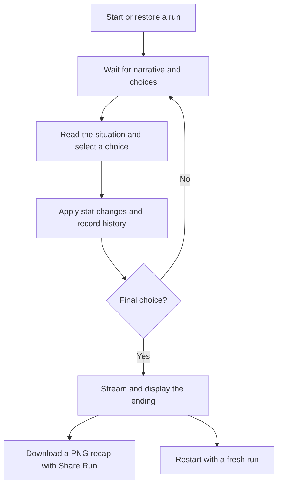

# AI gameplay workflow

FOMO Simulator turns player choices into a short life story in the AI era. AI
writes situations, choices, and an ending; the game applies choices and tracks
the run. A normal run lasts **five choices**.

## Journey at a glance

Restoring a saved playable event skips generation and shows the saved choices.
Restoring a completed run shows its saved ending, or requests one if still pending.

## 1. Start or resume

On a fresh run, all six player stats and both world stats start at 50. Player
stats are money, AI skill, network, energy, curiosity, and chaos. World stats are
AI hype and the economy. All these values stay between 0 and 100.

With AI requests enabled, a loading message and spinner appear while the opening
is generated. Opening and later events share a dry, grounded, satirical narrator policy.
The opening establishes an ordinary pressure and a commitment worth remembering. There is no prescribed winning path.

## 2. Read while choices are prepared

Narrative text appears progressively when the game can extract it from Claude's
response. The spinner remains visible until choices are ready. Some responses
may finish before a preview appears.

The full response must pass validation before choices become playable. The event
contains a title, description, and exactly three choices:

| Choice | Intended feel |
| --- | --- |
| Safe | Conventional or grounded, with quieter tradeoffs |
| Risky | An opportunity with real upside and downside |
| Absurd | A strange or playful alternative |

These categories do not guarantee success or failure. The English/Chinese toggle selects the language for the interface and generation.
Chinese mode uses native Chinese prompts for original Chinese scenes, choices,
and endings, with no English-to-Chinese translation pass.

## 3. Make a choice

Each generated choice already contains its stat effects. Selecting it immediately
applies those effects, clamps stats to their allowed range, records the decision,
and advances the turn. There is no separate AI call to judge the action's outcome.

History records the event, chosen action, and two unchosen options. Missed paths
are records of those options, not simulated alternate outcomes. The on-page
history shows the latest turn first. Duplicate selections for an event that has
already advanced are ignored.

Numeric stat panels are development aids and are hidden during production play.
Choice buttons display titles only, without detailed descriptions, category badges,
or colored backgrounds in either development or production. Final stats still appear in the downloadable recap.

## 4. Continue the story

Unless the action completed the run, the old playable event is cleared and the
next request begins. Claude receives updated player/world stats, the saved run length, and the full
bounded history of event titles, selected actions/types, scene excerpts, and
selected-action details. Later descriptions open with the consequence of the last
choice, then build the next dilemma from it. These are prompt instructions, not
a guarantee that every generated story will meet the quality bar.

Future branches are not pre-generated. Each new event is requested after the
player acts. Streaming lets the player start reading earlier, but the response
must finish before the next choices are playable.

Repeated system instructions are marked for prompt caching. Eligible cache hits
can reduce repeated input processing; they do not reuse old events or eliminate
output generation. The current short prompts fall below Haiku 4.5's cache-length
threshold, so that configuration does not gain cache hits. See the README for
technical caching details.

## 5. Receive an ending

After the fifth choice by default, the game marks the run complete. The final
event stays visible with disabled choices while an ending loading message and
spinner appear. Ending prose can also stream progressively.

The ending request uses final player/world stats and the full choice history.
Claude is instructed to resolve the final action through a concrete scene,
showing both gain and cost with an earlier callback rather than a stat recap. The validated
ending is displayed and saved, so refreshing does not rewrite it.

Run length is configurable from 1 to 100 and is retained in a saved run. Narrative
pacing follows that length, moving toward a final compromise. After five choices the internal turn
counter is 6, while history contains five turns.

## 6. Download the completed run

After the ending arrives, **Share Run** prepares a PNG recap locally. Clicking it
downloads `fomo-simulator-run.png` directly, without a native share sheet or image
upload. The image contains:

- The game title and ending title/summary.
- All six final player stats and both final world stats.
- The full chronological history, including choices and missed paths.

Built-in text and newly generated AI text use the selected language. Earlier
chosen history retains its original language.
The image includes the full run, independently of the visible browser viewport.
The player can send the downloaded file through any app they choose.

## Refresh, restart, and failures

| Situation | Player experience |
| --- | --- |
| Refresh while reading an event | The saved event and choices return. |
| Refresh during event generation | Updated progress is restored and a replacement event is requested. The previous choice is not applied twice; wording may differ. |
| Refresh while the ending is pending | The completed state is restored and the ending is requested again. |
| Restart | The save is cleared and a fresh run begins, retaining the language. Old generation results cannot overwrite the new run. |
| AI/network error, timeout, invalid response, or request limit | Static content replaces the failed event or ending. Partial AI text is discarded. Later turns can request AI again. |
| Invalid or incompatible save | The save is discarded and a fresh run begins. |

Saves live in that browser's local storage for the current site. There is no
account-based or cross-device save synchronization. Leaving the page cancels
generation; reopening a pending run requests new content rather than receiving
an old background result.

## Enabling AI gameplay

`VITE_AI_ENABLED=true` tells the browser to request backend content. The backend
also needs `AI_ENABLED=true` and a server-only `ANTHROPIC_API_KEY` to use Claude.
If browser API mode is enabled but server AI is off, the backend returns static
content. If browser AI is off, the game uses built-in content directly.

Restart the relevant local processes after changing settings. See
[README](../README.md) for setup and [CODEBASE](CODEBASE.md) for implementation
ownership and technical constraints.

AI pacing targets: event descriptions use two tense sentences (35-60 English
words or about 60-100 Chinese characters), keeping the prior consequence and a
concrete dilemma. Endings expand to 5-7 sentences (120-180 English words or about
220-350 Chinese characters) with callbacks, daily-life details and specific costs.
These are prompt targets rather than text truncation rules; the ending output
budget is 1,024 tokens. Static fallback prose is unchanged.

Endings explicitly use the post-final-choice player/world status as well as
choice history. Prompts in both languages ask for at least two salient status
aspects in concrete daily-life details, reflecting strengths and constraints
when supported, without listing scores or inventing extremes from average stats.

## Status-limit completion

After each action, the game clamps and checks all six player stats plus world
AI hype and economy. Any value at 0 or 100 completes the run immediately, even
when planned choices remain; the turn counter itself is excluded. The triggering
action is recorded and the counter increments once before ending generation.
Simultaneous limits are all supplied to the ending prompt as the central cause,
in both English and Chinese. Static fallback endings identify each limiting stat
and value, including in exported images. High values are not automatically wins.

Version-1 saves remain readable. Early completion is valid before maxTurns only
when a stat is at a boundary. Old unfinished saves already at a boundary after a
recorded choice now resume at the ending, retaining that choice and clearing any
old ending. Existing completed saves keep their saved ending. No extra choice is
applied on refresh. Ordinary runs still finish at their configured turn limit.
