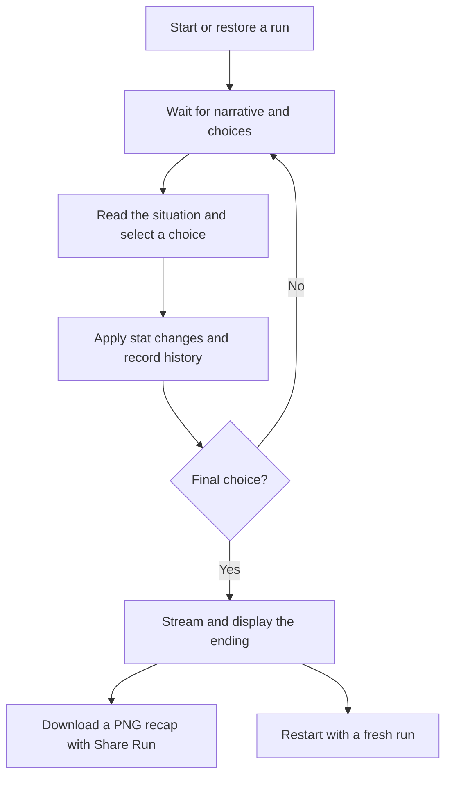

# AI gameplay workflow

FOMO Simulator turns player choices into a short life story in the AI era. AI
writes situations, choices, and an ending; the game applies choices and tracks
the run. A normal run lasts **five choices**.

## Journey at a glance

Restoring a saved playable event skips generation and shows the saved choices.
Restoring a completed run shows its saved ending, or requests one if still pending.

## 1. Start or resume

On a fresh run, all six player stats and both world stats start at 50. Player
stats are money, AI skill, network, energy, curiosity, and chaos. World stats are
AI hype and the economy. All these values stay between 0 and 100.

With AI requests enabled, a loading message and spinner appear while the opening
is generated. The opening uses a detailed narrator prompt intended to produce a
personal, grounded situation with a dry, witty voice. Later events use a shorter
prompt. There is no prescribed winning path.

## 2. Read while choices are prepared

Narrative text appears progressively when the game can extract it from Claude's
response. The spinner remains visible until choices are ready. Some responses
may finish before a preview appears.

The full response must pass validation before choices become playable. The event
contains a title, description, and exactly three choices:

| Choice | Intended feel |
| --- | --- |
| Safe | Conventional or grounded, with quieter tradeoffs |
| Risky | An opportunity with real upside and downside |
| Absurd | A strange or playful alternative |

These categories do not guarantee success or failure. The English/Chinese toggle
localizes the interface and built-in content; AI-generated prose stays in English.

## 3. Make a choice

Each generated choice already contains its stat effects. Selecting it immediately
applies those effects, clamps stats to their allowed range, records the decision,
and advances the turn. There is no separate AI call to judge the action's outcome.

History records the event, chosen action, and two unchosen options. Missed paths
are records of those options, not simulated alternate outcomes. The on-page
history shows the latest turn first. Duplicate selections for an event that has
already advanced are ignored.

Numeric stat panels and choice-type badges are development aids and are hidden
during production play. Final stats still appear in the downloadable recap.

## 4. Continue the story

Unless the action completed the run, the old playable event is cleared and the
next request begins. Claude receives the updated player/world stats and the last
three history entries, including event titles and selected action labels.

Future branches are not pre-generated. Each new event is requested after the
player acts. Streaming lets the player start reading earlier, but the response
must finish before the next choices are playable.

Repeated system instructions are marked for prompt caching. Eligible cache hits
can reduce repeated input processing; they do not reuse old events or eliminate
output generation. The current short prompts fall below Haiku 4.5's cache-length
threshold, so that configuration does not gain cache hits. See the README for
technical caching details.

## 5. Receive an ending

After the fifth choice by default, the game marks the run complete. The final
event stays visible with disabled choices while an ending loading message and
spinner appear. Ending prose can also stream progressively.

The ending request uses final player/world stats and the full choice history.
Claude writes a short title and summary reflecting the journey. The validated
ending is displayed and saved, so refreshing does not rewrite it.

Run length is configurable. The narrator's internal 20-turn world arc does not
override the default five-choice rule. After five choices the internal turn
counter is 6, while history contains five turns.

## 6. Download the completed run

After the ending arrives, **Share Run** prepares a PNG recap locally. Clicking it
downloads `fomo-simulator-run.png` directly, without a native share sheet or image
upload. The image contains:

- The game title and ending title/summary.
- All six final player stats and both final world stats.
- The full chronological history, including choices and missed paths.

Built-in text uses the selected language; generated AI text remains English.
The image includes the full run, independently of the visible browser viewport.
The player can send the downloaded file through any app they choose.

## Refresh, restart, and failures

| Situation | Player experience |
| --- | --- |
| Refresh while reading an event | The saved event and choices return. |
| Refresh during event generation | Updated progress is restored and a replacement event is requested. The previous choice is not applied twice; wording may differ. |
| Refresh while the ending is pending | The completed state is restored and the ending is requested again. |
| Restart | The save is cleared and a fresh run begins, retaining the language. Old generation results cannot overwrite the new run. |
| AI/network error, timeout, invalid response, or request limit | Static content replaces the failed event or ending. Partial AI text is discarded. Later turns can request AI again. |
| Invalid or incompatible save | The save is discarded and a fresh run begins. |

Saves live in that browser's local storage for the current site. There is no
account-based or cross-device save synchronization. Leaving the page cancels
generation; reopening a pending run requests new content rather than receiving
an old background result.

## Enabling AI gameplay

`VITE_AI_ENABLED=true` tells the browser to request backend content. The backend
also needs `AI_ENABLED=true` and a server-only `ANTHROPIC_API_KEY` to use Claude.
If browser API mode is enabled but server AI is off, the backend returns static
content. If browser AI is off, the game uses built-in content directly.

Restart the relevant local processes after changing settings. See
[README](../README.md) for setup and [CODEBASE](CODEBASE.md) for implementation
ownership and technical constraints.
